# Slim Diamond: soldering and assembly

The module, battery and battery socket all end up inside the case, under the PCB. Only the USB-C port and the power-switch lever show, through openings in the outer wall: a recess the size of a cable's plug in front of the port, and a slot open to the top for the lever. Push the lever with a fingernail. The module's LED and its own reset button face the case floor, so flash and test it before closing the case. A second reset button on the switch face, wired to the module's reset pad, works with the case closed: it sits in a cone in the plate, above the thumbs.

Everything is soldered with an iron: no paste, no hot air. Build one half at a
time. Both halves use the same PCB, turned over for the right half.

**The module** is a Seeed XIAO nRF52840 or a NologoTech Super52840. The board takes either: a battery selector, set in step 1, matches it to your module. The other steps are the same for both.

## Tools

- Temperature-controlled iron with a **small chisel tip** (1.6–2 mm) for the module, sockets and JST tabs, and a **fine conical tip** for the power switch.
  - Leaded solder: about 330 °C.
  - Lead-free: about 360 °C.
- Thin solder (0.5–0.6 mm), a **flux pen**, fine tweezers, kapton tape, isopropyl alcohol and a brush.
- A multimeter with a continuity beep.
- Optional: a magnifier or phone camera to inspect the small pads.

## The two faces

Each board has a **parts face** and a **switch face**. The silkscreen tells you which is which:

| Half | Parts face (silkscreen) | Switch face |
|---|---|---|
| Left | `LEFT: parts on this face` | the other one |
| Right | `RIGHT: parts on this face` | the other one |

- **Parts face:** the module, power switch, JST socket and the 12 hot-swap sockets. It faces the case floor.
- **Switch face:** the key switches clip in here, the reset button is soldered here, and you bridge the jumpers and fill the module's holes from this side.

The module always lies flat on the parts face, with its pad side against the PCB and its components (USB-C, shield, reset button) pointing away from it, towards the case floor.

## Before you start

- **Flash and test the module first.** Plug it into USB and double-tap reset: a USB drive appears. Copy the firmware onto it:

  | Half | With a dongle | Without a dongle |
  |---|---|---|
  | Left | `slim_diamond_peripheral_left-zmk.uf2` | `slim_diamond_central_left-zmk.uf2` |
  | Right | `slim_diamond_peripheral_right-zmk.uf2` | `slim_diamond_peripheral_right-zmk.uf2` |

  A dead module is much easier to swap now than after soldering.
- **Battery size and polarity.** The halves use nominal **7 × 20 × 40 mm, 500 mAh** cells; the trackball and trackpad keep **752025, 250 mAh** cells. Verify actual dimensions and lead clearance before assembly. Silkscreen `+` marks pin 1 of the JST socket. Cells ship with either polarity: check the plug with the multimeter. If reversed, swap the two crimps in the disconnected plug housing (lift each tab with a needle), keeping the contacts insulated from each other.
- **Magnet polarity.** Every left-half magnet goes in with the same pole facing out, and every right-half magnet with the other pole. That makes both the stack and the side-by-side join attract. Mark one face of each magnet stack before you start.

## 1. Bridge the D0–D2 jumpers and the battery selector (switch face)

On the switch face, inside the module's outline, there are three small pad pairs labelled **D0, D1, D2**, on the face without the module. Flux them and bridge each pair with a small blob of solder.

Next to them is the **battery selector**: two rows of two pad pairs, labelled `+MID` and `+USB`. The two modules have their battery pads in the same spots, swapped, and the row you bridge decides which battery hole is +:

| Module | Bridge both pairs in row |
|---|---|
| Seeed XIAO nRF52840 | `+MID` (its + pad is the one nearer the module's middle) |
| Super52840 | `+USB` (its B+ pad is the one nearer the USB end) |

**Bridge one row only.** Both rows short the battery; the wrong row connects it backwards. Both halves get the same row.

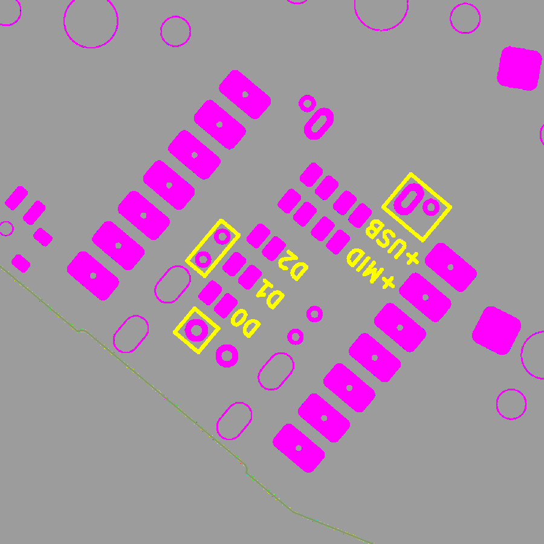
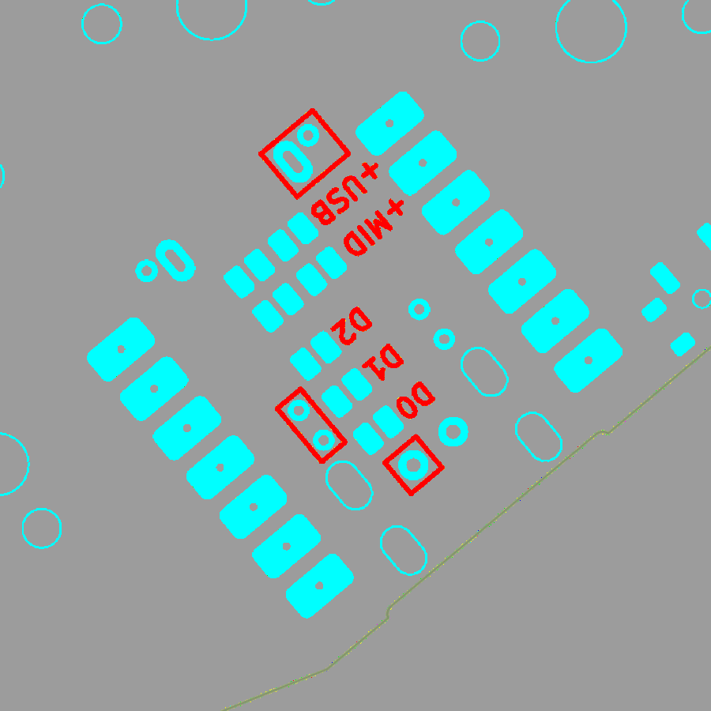

*Left: the left half's switch face. Right: the right half's switch face. Bridge the three D0–D2 pairs and one selector row, and later fill the three boxed hole groups (step 2).*

Leave the jumpers on the other face open: they're on the parts face, under where the module will sit.

**Check:** each bridged pair beeps on the multimeter, and the unbridged selector row doesn't.

## 2. Solder the module (parts face)

0. **Pre-tin the module's underside pads** that the boxed holes reach: the two battery pads (VBAT and GND on the XIAO, B+ and B- on the Super52840), the P0.09 pad (NFC1 on the XIAO, `009` on the Super52840) and RST. Flux each one and touch it with a lightly tinned iron, leaving a thin, flat coat. Wick off any bump: a blob lifts the module off its edge pads. In step 4 the solder fed into each hole then only has to melt into the coat that's already there.
1. Flux the 14 edge pads. Lay the module flat over its outline with the USB-C end towards the board edge. The pads are pulled out past the module, so you can reach them from the side.
2. **Tack two opposite corners:** put solder on the iron, touch it to the board pad and the castellation together, and let it flow. Check the module is flat and every castellation sits over its pad. Reheat a corner to adjust it.
3. Solder the other 12 edge pads the same way: iron on the board pad, solder fed into the castellation. Each joint should be a small concave fillet up the half-hole.
4. **Turn the board over (switch face up). Fill the boxed holes:** the pair inside one box (the battery), both holes in the second box (P0.09: one under each module's pad, so fill both), and the round hole in the small square box near the USB end (RST, the module's reset pad). Hold the iron on the ring for 2–3 s and feed solder into the hole until it fills and stops sinking. This alone does not prove a good joint: check continuity to accessible points on the module and inspect for shorts before applying power.
   **Fill only the boxed holes.** The unboxed ones belong to the other half. Most sit under bare module areas; the unboxed reset hole sits under the module's GND test pad, and only wires to the other half's (empty) button pads, so it does no harm either way.
5. Clean off the flux.

The battery holes and one P0.09 hole are smaller than the rest (0.6 mm, as large as the pads above them allow): flux them well, use thin solder (0.5 mm), and hold the iron on the ring until the solder sinks into the hole before you feed more.

**Check:**
- **Before any battery goes in:** the power switch's middle pad (VBAT; the switch is fitted in step 3) must **not** beep to the module's GND castellation. A beep may indicate the wrong selector row, both rows bridged, or another short: find and fix it first.
- The battery hole the selector made + beeps to the power switch's middle pin.
- The RST hole does **not** beep to GND (the module's reset is pulled up inside the module: a beep means a solder bridge, and the half would sit in reset).
- No two adjacent castellations beep to each other.

## 3. Power switch, MSK-12C02 (parts face)

It goes next to the module's USB-C, with the lever pointing out over the board edge and its two locating pegs in the small holes.

1. Tin one of the four corner (shield) pads. Place the switch with tweezers and reheat that pad to tack it.
2. Solder the other three shield pads.
3. Solder the three signal pads with the fine tip and very little solder. A bridge between the middle pin and its near neighbour does no harm (both are VBAT). A bridge from the middle pin to the far one bypasses the switch: wick it away.

## 4. JST battery socket (parts face)

Its opening faces the battery's spot under the inner keys. Tack one signal pin, check it sits flat, and solder the other pin. Then solder the two large mounting tabs: they need more heat and more solder, because they take the force of plugging the battery in.

## 5. Hot-swap sockets (parts face)

Twelve, one per key. Each socket fits its outline only one way round.

1. Tin one pad lightly, place the socket, and hold it flat with tweezers while you reheat the pad until the socket's metal tab sinks into the solder.
2. Solder the second tab. Use enough solder to make a fillet, but keep it out of the socket's opening.

## 6. Reset button, TS-1187A (switch face)

It goes on the **switch face**, in the gap above the thumb keys, inside its outline labelled `RST`. The part is square and symmetric: any of the four ways round works.

1. Tin one corner pad, hold the button flat and centred with tweezers, and reheat the pad to tack it.
2. Solder the other three legs: a small fillet on each, iron on the pad and against the leg. Keep the solder off the body: the button is 2.0 mm tall and the plate's pocket over it leaves only 0.3 mm above the collar.

**Check:** the RST hole (step 2.4) beeps to the two legs on the `RST` side of the button (the side with the label), and beeps to GND only while you press the button.

## 7. Test (before the case)

1. Plug in USB. With the firmware flashed and your computer paired or connected, short each socket's two contacts with tweezers. Every key should register.
2. Plug in the battery, unplug USB and toggle the power switch: the half should stay connected.
3. Press the reset button once: the half reboots (it disconnects and reconnects). Reconnect USB, then press it twice quickly: a USB drive appears (the bootloader), as with the module's own button.

| Symptom | Look at |
|---|---|
| One key dead | That socket's two joints |
| Pinky, ring-bottom or middle-home dead | Its D0–D2 jumper (step 1) |
| Index-top dead (both halves) | The NFC1 / P0.09 hole (step 2.4) |
| Works on USB, not on battery | The battery holes, the selector row (step 1), the power-switch joints, battery polarity |
| Reset button does nothing | The RST hole (step 2.4) and the button's legs (step 6) |
| Half never starts, or keeps rebooting | RST bridged to GND: the RST hole or the button's legs |
| Nothing works | The module's castellations, or the firmware file |

## 8. Case and plate

The base is solid up to the PCB's underside, with a pocket for every part. The PCB rests on plastic everywhere, which makes the half stiff and quiet. The top plate covers the whole board: the switches clip into it, and a shallow pocket in its underside clears the solder around the module.

1. Fit **13 common 8 × 1.5 mm N52 discs per half** (polarity!): seven underneath and six along the seam. Dry-fit first, without forcing the plastic, then apply a little suitable adhesive. Keep adhesive off the mating faces.
2. Lay the battery in its bay and plug it into the JST socket. The plug and the slack of its leads sit in the bay, between the battery and the socket.
3. Lower the PCB, parts face down, into the base. Each part drops into its pocket, the switch lever slides down its slot, and the USB-C port lines up with its recess. Nothing should need force: every pocket has 0.6 mm of clearance, and the PCB 0.5 mm to the outer walls.
4. Lay the plate on top, its pillars and screw bosses resting on the PCB, and fit the four **M3 × 8 flat-head** screws through the plate and PCB. They cut their own thread in the Nylon: turn them in slowly, and stop when the heads sit flush in their countersinks.
5. Clip the switches through the plate into the sockets, then fit the keycaps.
   The reset button now sits under a cone in the plate, between the index finger's bottom key and the thumbs. Its plunger is 0.2 mm under the plate's top, so keycaps and palms don't reach it.
6. **Anti-slip pads.** Each floor has five slots, each long enough for two pads. Stick one 8 × 2 mm bump-on into **one end** of every slot and leave the other end empty: when the halves are stacked back to back, the other half's pad drops into that empty end, so the floors and magnets still meet.

   The rule is the same on both halves: turn the half over and go **clockwise round the floor**. In every slot, the pad goes in the end you reach **second**. Then each half's five pads sit in the ends the other half leaves empty.

   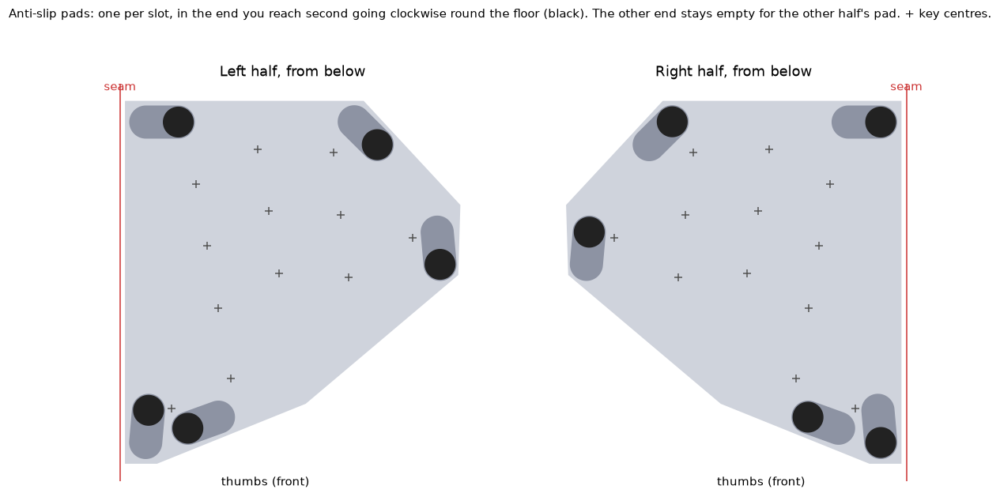

   Clean the slots with isopropyl alcohol first and press each pad down firmly against the slot's roof, centred in its round end. Stack the halves to check: they should close flat, with no rocking.

## Optional stands and drawer retention

- Use the same **8 × 1.5 mm N52 discs everywhere**. The dock takes six wing magnets and six side magnets per half, **three base pairs** (three of those discs are glued to the Ugreen base) and one upward-facing disc in the drawer floor: **31 discs total**. No underside contact sits near the drawer retention magnet: at least 1 mm of plastic separates their pockets, even with each 0.2 mm off. Leave the rear free for USB and the cable.
- Each drawer insert takes three evenly spaced side magnets per side (seam positions 2, 4 and 6). The halves and dock have six per side at 17.8 mm pitch; the inserts use every other position. Check the full half → dock → insert polarity chain before gluing.
- Each pointing module also takes **one disc in its floor**, on the centreline, directly above the drawer's. Glue both flush or slightly recessed, opposite poles facing. They grip the module from below, whatever the side magnets manage through the walls.
- The nominal magnet pockets are Ø8.3 mm for 8 mm discs; never force a magnet in.
- To take a module out, hold the dock and push the tip of the rear hood forwards with a finger through the dock's rear passage, then pull the module out of the front. Unplug USB first.
- The USB-C port is nominally flush with the module's back, with nothing under it. Feed a plug through the dock's **12.8 mm rear passage**. A 12.35 × 6.5 mm overmold is the nominal modelled envelope, not a guaranteed fit for every plug or printed dock; check the real plug, cable and passage.
- The rear hood and the dock meet at a 45° slope with 0.4 mm clearance.
- For independent tenting, print `case/stand_magnet_template_left.svg` and `case/stand_magnet_template_right.svg` at 100% and check the 54 mm boundary with a ruler. Glue three discs to each stand's **tilting phone platform**, not its base; the patterns are mirrored and the magnet centres form a 44 mm circle.
- The platform needs a clear flat 54 mm patch. Use **2.0 mm bump-ons**. Start flat, support the half while increasing the tilt, then test typing on it before relying on it.

## Pointing modules

Both modules are built the same way as a half: a **tray**, a **lid**, and the same **M3 × 8 flat-head screws** going in from the top. The tray is one print, shared by all of them. Only the lid changes: `trackball/case/lid.stl` (MX), `trackball/case/lid_choc.stl` (Choc v1) or `trackpad/case/lid.stl`.

The raised lid has upper facets on its **front and both sides**, starting at the halves' top-surface height. Below that height the front keeps the drawer's matching profile for horizontal removal.

| The parts, lid raised | Closed |
|---|---|
| 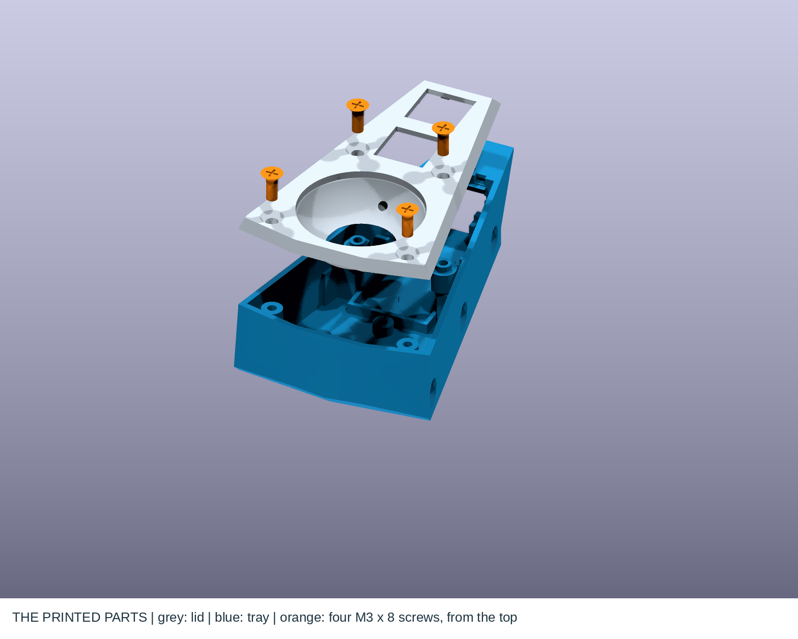 | 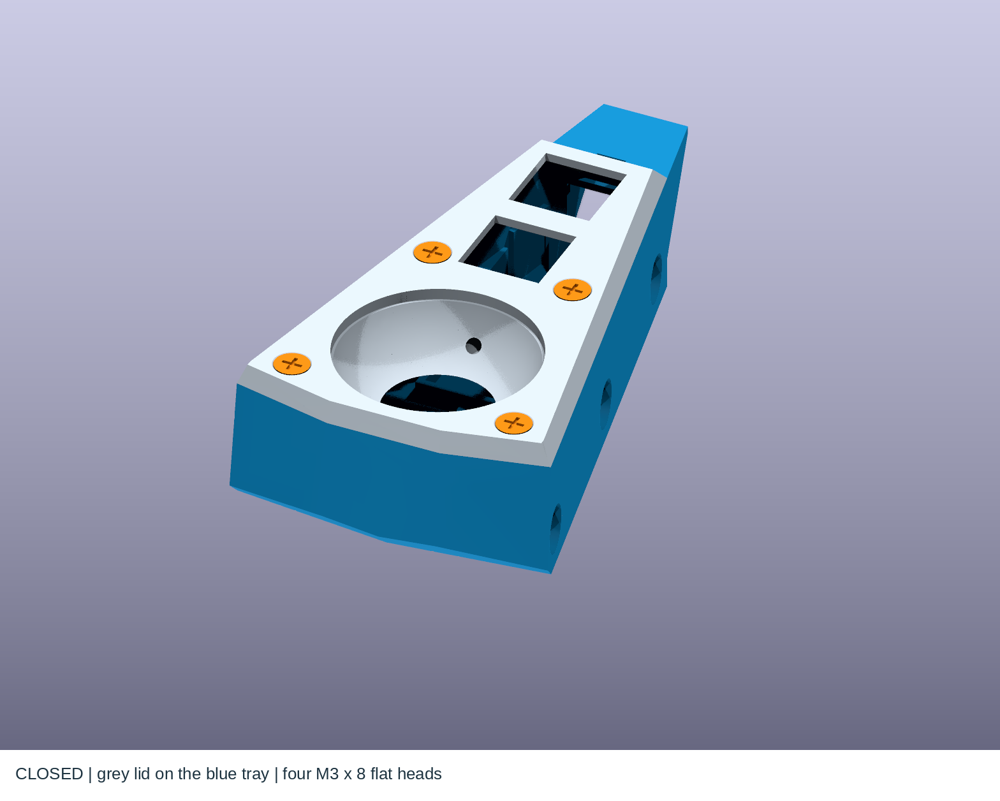 |
|  | 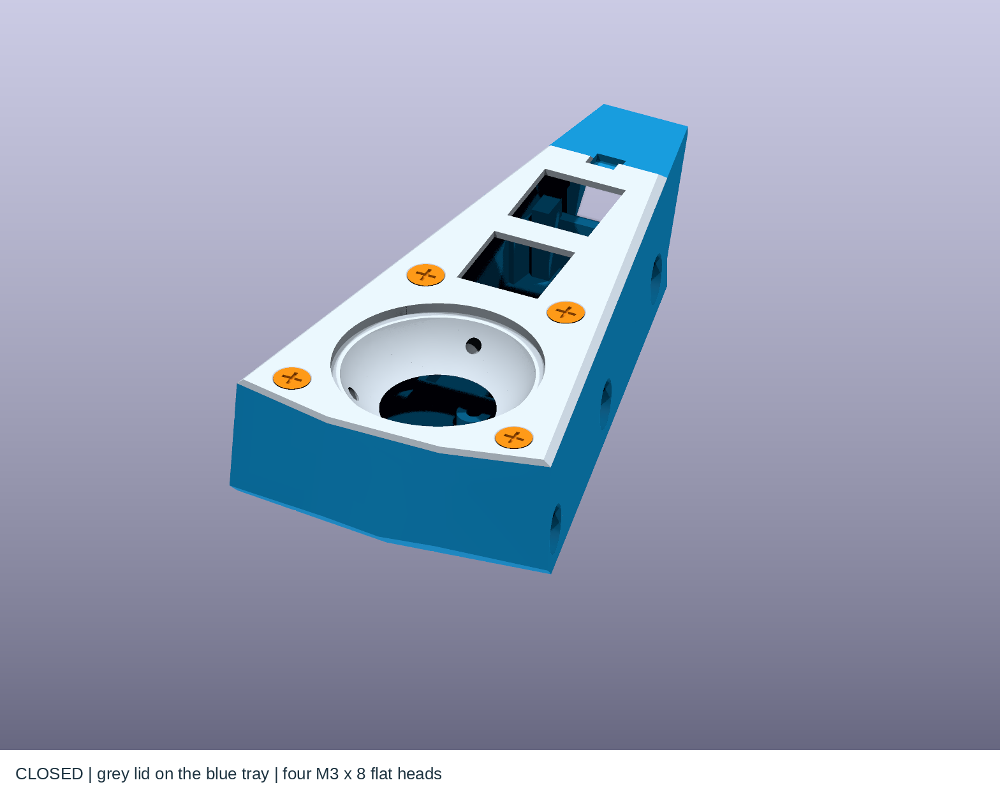 |
| 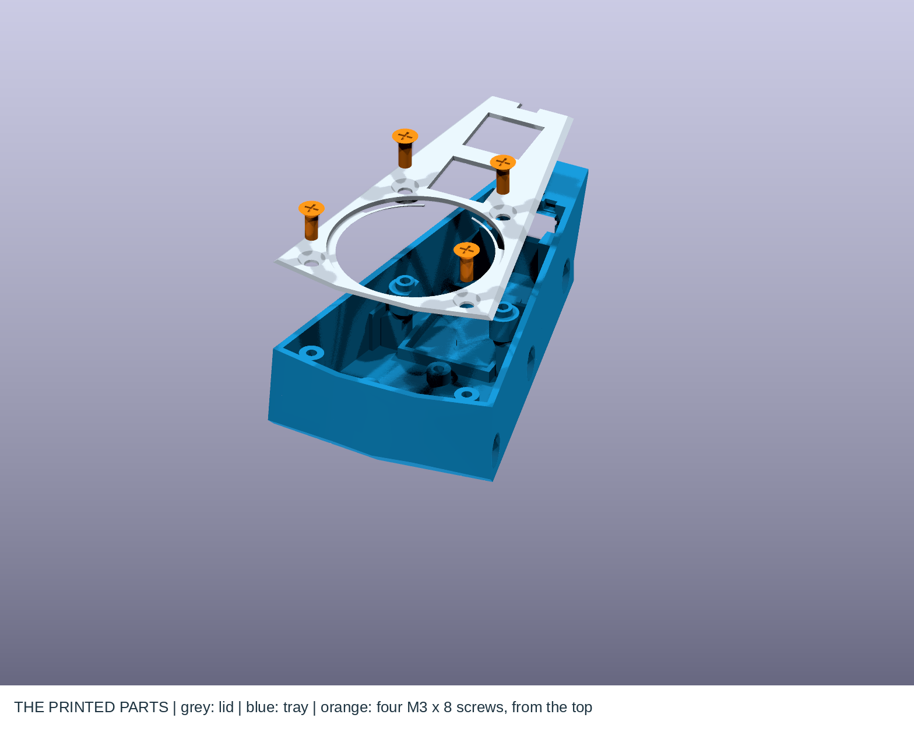 | 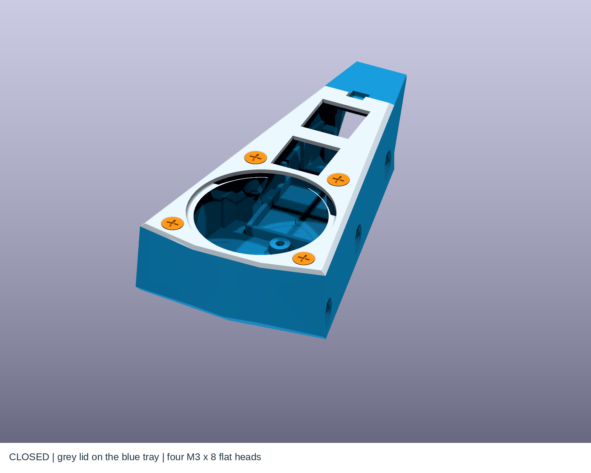 |

The same main board holds the two keys and the power switch on both modules. A battery and the controller, on its own small board, sit under it. The same sensor board holds the reset button at the front; on the trackpad it carries nothing else. Everything is hand-soldered with an iron: no paste or hot air. The trackpad retains its supplied I²C breakout and flat cable, plus a separate DR wire.

**One panel, either controller:** order `trackball/fab/trackball_jlcpcb.zip` for a nice!nano v2 **or** a plain Seeed XIAO nRF52840, for either pointing module. The panel has three boards: the main board, the sensor board and the **controller board**.

The controller stands face down on the controller board on an ordinary 2.54 mm pin header, its pins in two straight columns 15.24 mm apart. Eight stacking pins then join the controller board to the main board above it, beside the controller. The six signal pins land on GPIOs on both controllers, so they need only the right firmware. One solder jumper chooses the 3.3 V pin. Two wires of about 25 mm, the same on both controllers, carry the battery and reset.

**The main board does not lift out afterwards:** removing it means desoldering the eight stacking pins. Solder and test everything beneath it first.

USB always plugs directly into the chosen MCU's **onboard USB-C receptacle**. There is no external USB connector, extension or soldered USB wiring.

### Boards

1. **Snap the panel.** The main board and sensor board are joined by one long bridge with a row of holes at each end, and the controller board hangs off the sensor board's side, a quarter turn round, on a short tab with a row of holes at each end of its own. The tab meets it in its USB notch. Snap the controller board's tab first, then the bridge: hold a board in one hand and the bridge in the other (pliers help) and bend at the row of holes until it snaps. File off the stubs.
2. **Main board.** Solder the MSK-12C02 power switch on the front face (the side marked `MCU BOARD BELOW`), with its lever over the rear edge. Solder one family of hot-swap sockets on the back face: Kailh MX for the MX lid, Choc for the Choc lid and the trackpad. Never both.
3. **Sensor board, trackball.** Solder the regulator, capacitors, resistor and TS-1187A reset button on the back face, the PMW3610 in its cut-out, and clip on the lens.
4. **Sensor board, trackpad.** Solder only the TS-1187A reset button, on the back face.

5. **Controller board.**
   - **Set the jumper,** on the underside, the face without `MCU FACE DOWN`. Bridge the middle `3V` pad to `X` for a XIAO or `N` for a nice!nano. Never bridge all three: on a nice!nano that ties reset to the 3.3 V rail.
   - **Fit the header.** Cut two 5-pin lengths of standard 2.54 mm header. Before you solder anything, try a pin in the controller's holes: Seeed's model shows them narrower than a square pin's diagonal, so a pin may need a firm press. Set the short ends down through rows 3 to 7 of each column from the top face, so the plastic sits on the top face and the long ends stand up, then solder them from underneath. Pull one loose pin from a spare length and solder it into the left column's row 2, the single hole behind the strip, at the USB end, at the same height: the tray's magnet boss leaves no room for plastic there. Trim the tails underneath to about 1 mm.
   - **Flash the controller first,** while its reset is in reach, then **fit it** face down, its USB-C over the notch. Rest it on the plastic, level, and solder the pins on its back. Trim them to 0.6 mm at most above the controller: the sockets are close above it. Power it from USB and check that it connects: its keys and sensor are not joined until the stacking pins are soldered. Solder its two wires now, about 25 mm each: battery and reset, from the table under Wiring. They will not reach the main board yet.
   - **Fit the stacking pins** last, keeping them square. Use 15 mm extra-long header with a short end of at least 2.35 mm and a long end of at least 6.7 mm: two 3-pin lengths for the columns beside the controller, and one pin each for the two outer holes. Sand the cut ends of the plastic flush, so they sit square. Their plastic belongs near the **main board's underside**, not this board. Fit the short ends up into the main board's eight stacking holes. On the left, three in a line: `K2`, the outer hole of the joined `CS` pair, and `K1`, with `GND` set further out ahead of them. On the right, the outer holes of the joined `CK`, `IO` and `MO` pairs in a line, and the outer hole of the joined `3V` pair set further out ahead of them. The stacking `GND` is not the pad marked `G`, which takes a wire. Then stand the main board over this board on a 6.75 mm spacer (6.6 to 6.9 mm works), with the long ends down through this board's holes. Solder them to **this board only**, from underneath. Lift the main board off, and trim the tails underneath to about 1 mm.

For the trackball sensor board, use these values at the PCB references: C1 3.3 µF; C2, C3 and C4 100 nF; C5 and C7 10 nF; C6 10 µF; C8 and C9 1 µF; R1 10 kΩ. Match the regulator and PMW3610 pin 1 to the footprint markings and check the manufacturer drawings before soldering. Solder with an iron, inspect the joints under magnification and check adjacent pins for shorts. Keep the lens clean and do not touch its optical surfaces.

Some sensor-board silkscreen labels overlap. Do not identify wires by silkscreen alone: in the KiCad panel, inspect pad references `SJ1` through `SJ7`, whose nets are respectively `S_VCC`, `S_GND`, `S_RST`, `S_SCLK`, `S_SDIO`, `S_NCS`, `S_MOTION`. Meter each pad to its intended component or reset button before soldering.

### Wiring

Use flexible 30 AWG stranded wire. The main board's pads have short labels: `3V` is VCC, `G` is GND, `CK` SCLK, `IO` SDIO, `CS` NCS and `MO` MOTION. Solder both of these to the main board before it goes in, and keep it beside the tray on its wires while you fit the parts below it. Run the `CK`, `IO`, `MO` and `CS` wires inboard of the stacking pins' plastic: that is the only way out of those holes, and a wire left outboard gets trapped. The main board's labels are small: down its right edge, rear to front, the pads are `R2`, `RST`, `VBAT`, `CK`, `IO`, `MO` and `3V`, and on its left `G` and `CS`, with `K2`, `K1` and `GND` marking stacking holes.

| From | To |
|---|---|
| Battery + / − | Main board `+` / `-` pads (the switch is on the board) |
| Sensor board `VCC`, `GND`, `RST` | Main board `3V`, `G`, `RST` |

Two wires of about 25 mm run from the controller to the main board, the same on both controllers. Check that length against your own route before cutting. They go on the controller first, and into the main board last, from above:

| Controller | To main board `VBAT` | To main board `R2` | Jumper |
|---|---|---|---|
| nice!nano v2 | B+ | RST, on its pin | `3V` to `N` |
| Plain XIAO nRF52840 | BAT+ pad on its back | Reset pad on its back | `3V` to `X` |

Do not connect `VBAT` to 3V3/VCC, and leave a XIAO's 5V pin empty. The header's row 1 does not reach the board at all, so the battery cannot land on that pin by accident. The same D-number means **different GPIOs** on these controllers: follow the names in the diagrams and confirm the actual module's markings before soldering.

| Plain XIAO nRF52840 | nice!nano v2 |
|---|---|
| 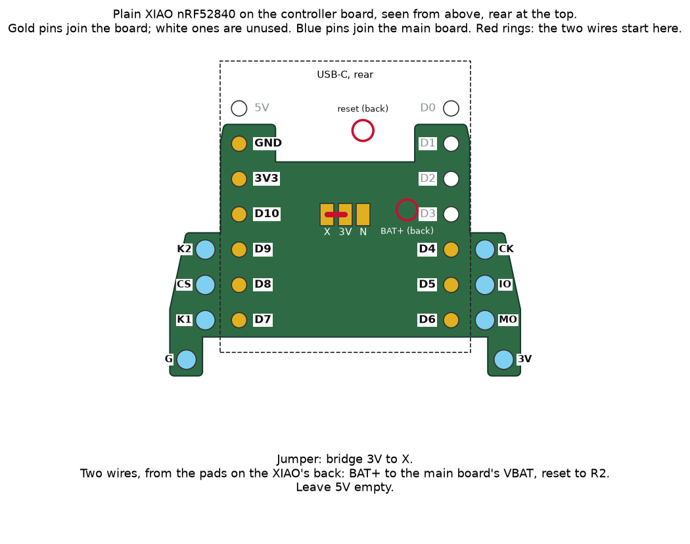 | 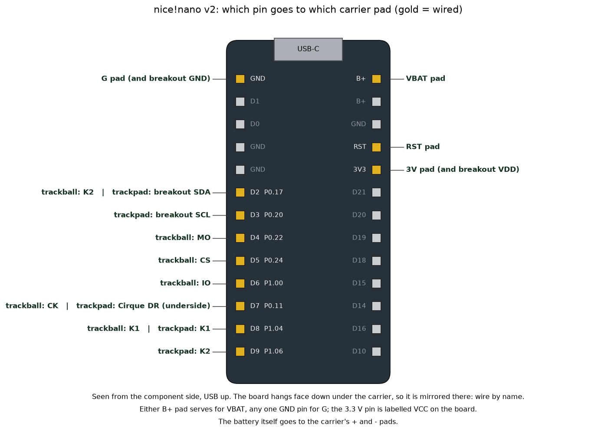 |

Each signal takes the same controller pin on both modules. The stacking pins carry them, along with `G`, `3V`, `K1` and `K2`:

| Pad | nice!nano v2 pin | Plain XIAO pin |
|---|---|---|
| `CK` | D2 (P0.17) | D4 (P0.04) |
| `IO` | D3 (P0.20) | D5 (P0.05) |
| `CS` | D20 (P0.29) | D8 (P1.13) |
| `MO` | D4 (P0.22) | D6 (P1.11) |
| `K1` | D19 (P0.02) | D7 (P1.12) |
| `K2` | D21 (P0.31) | D9 (P1.14) |

On the **trackball**, also wire the sensor board's `SCLK`, `SDIO`, `NCS` and `MOTION` to the main board's `CK`, `IO`, `CS` and `MO` pads, which sit beside their stacking pins.

Verify the clone's pin labels and USB location against a genuine nice!nano v2 before wiring; clones can differ. The power switch is between the cell positive and B+, not between the controller and its regulated VCC. Insulate the battery leads while wiring, check polarity and continuity with the battery disconnected, and confirm there is no short between supply and ground before connecting it.

Use `slim_diamond_trackball` for nice!nano or `slim_diamond_trackball_xiao` for XIAO. The XIAO shield turns off I²C1 and the serial port, so that the sensor can use D4 and D5 and the other signals D6 and D7.

On the **trackpad**, retain the supplied **I²C breakout PCB and its 12-pin flat cable**. Solder four flexible wires from the breakout's `VDD`/`VCC`, `GND`, `SDA` and `SCL` pads to the main board's `3V`, `G`, `IO` and `CK` pads. Solder one additional wire directly from the Cirque's underside **DR/data-ready** test pad to the `MO` pad; this does not replace the flat cable. Confirm DR by continuity to connector J1 pin 4 before soldering. Use the breakout's two pull-ups to **3.3 V**, not 5 V; verify their population and the kit's pad order with its schematic/meter rather than wire colours. Cable orientation matters: check the supplied FFC contact orientation and the breakout's pin reversal before applying power.

Configure the Cirque for I²C: order a `TM040040-2023-302` flat-overlay I²C version, or verify the kit's SPI-labelled board has R1 removed. If R1 is still fitted, remove it with a short iron touch and wick away any bridge; protect the nearby FFC connector. Keep R7 and R8 fitted for this 3.3 V design—do not apply the 5 V conversion. See [the adapter guide](https://keycapsss.com/help/cirque-trackpad/) and the Cirque data sheet. Leave the common sensor PCB's trackball components and `CK`/`IO`/`CS`/`MO` connections unpopulated; wire only its reset and ground (its unpopulated VCC connection is optional).

The firmware uses Zephyr's Pinnacle driver and assumes a directly wired, active-high DR signal. Test startup, motion, primary tap, sleep and wake on the actual pad; interrupt startup and driver calibration have not been physically verified. The PMW3610 trackball firmware likewise compiles but the shared SDIO line and bus turnaround have not been electrically tested.

| Trackpad signal | nice!nano v2 pin | Plain XIAO pin |
|---|---|---|
| SCL (breakout), on pad `CK` | D2 (P0.17) | D4 (P0.04) |
| SDA (breakout), on pad `IO` | D3 (P0.20) | D5 (P0.05) |
| DR (Cirque underside), on pad `MO` | D4 (P0.22) | D6 (P1.11) |
| K1 | D19 (P0.02) | D7 (P1.12) |
| K2 | D21 (P0.31) | D9 (P1.14) |
| Breakout GND, on pad `G` | GND | GND |
| Breakout VDD/VCC, on pad `3V` | VCC (3.3 V) | 3V3 |

Use `slim_diamond_trackpad` for nice!nano or `slim_diamond_trackpad_xiao` for XIAO. Both use I²C at 100 kHz and address `0x2A`. Never connect breakout VDD/VCC to raw battery voltage or USB 5 V. Both I²C firmware variants compile; physical communications, tap, sleep and wake still need testing.

On the **plain XIAO nRF52840**, the `VBAT` and `R2` wires start on the two small pads on its back. Keep them flat across its back, not crossing, and off towards the rear of the sockets above it. The battery's negative needs no wire to the XIAO: the `-` pad is ground on the main board, and ground reaches the XIAO through the stacking pins and header. Use Seeed's [front and back pinout](https://wiki.seeedstudio.com/XIAO_BLE/#hardware-overview) to identify the pads on the actual board. Insulate each joint and check polarity and shorts with the cell and USB disconnected.

**Super52840:** battery-pad locations differ and reset, charger and regulator details depend on the actual revision; compatibility remains experimental until verified against that board's schematic and measurements. Do not assume the Seeed battery, reset or charging pinout applies. The XIAO firmware variants compile but have not been tested on hardware.

### Into the tray

Work in this order, power off, with the magnets already glued in. Before putting the battery in, perform the sensor screw depth check in step 2. The picture shows the first three steps done.

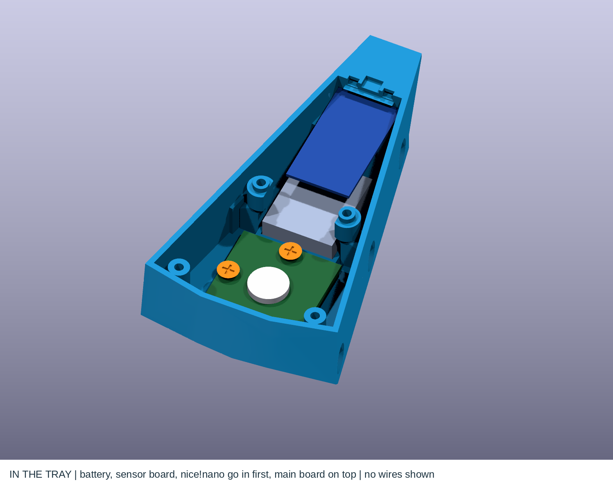

1. **Battery.** Lower it straight into its cradle. Its 7.5 mm thickness has room to spare, but measure a protected pack first, including tape, tabs and leads. Never force it.
2. **Sensor board.** Before installing the battery, check the two M3 × 8 screws against the actual PCB, posts and floor: the PCB holes are not countersunk, and screw-head dimensions and shim thickness affect the available depth. Do not drive a screw into the floor or toward the battery; the required engagement and clearance have not been physically verified. Trackball: determine the actual unshimmed distance **H** from the top of the board on the posts to the ball surface on the optical axis with the lid, bearings and ball seated. Measure **X** from the board top to the lens reference plane specified by the PMW3610 data sheet. Place one equal-thickness shim under each post, each of thickness **H − X − 2.4 mm**, and verify the assembled reference-plane-to-ball gap is 2.2–2.6 mm. The nominal model gives H = 4.8 mm, but actual dimensions may differ. If the calculated thickness is negative, shimming cannot correct it: do not force the assembly. Trackpad: no optical gap to set, but put the same **0.4 mm** washer under each post: the posts print 0.4 mm low, and without it each screw tip lands exactly on the bottom of its pilot, with no clearance. Fit the board parts face down only after checking screw depth.
3. **Controller on its board.** Hold the stack with the front tilted up, about 18°, and lower it in about 3 mm forward of its place. Move it back so the USB end goes in first: a nice!nano's board edges go into the two pockets in the back wall. Lower the front until the board's ears rest on their seats, with the ribs ahead of its arms and the small posts behind its rear corners. These stops take a plug's push and pull, with about 0.4 mm of play on a nice!nano and 0.65 mm on a XIAO. A thin double-sided tape (0.25 mm at most) on the seats keeps the board down. Check that the USB-C mouth lines up with the opening, and test a real plug before going on. A XIAO's mouth sits 0.2 mm inside the back. The cell's end is 0.4 mm ahead of the board, so make sure no battery tape or wire is caught there.
4. **Main board.** Before lowering it, meter the stack: `3V` and ground must not beep together, and each stacking pin must beep to its header pin. Then lower the board flat, feeding the eight stacking pins through those eight holes, and the controller's two wires up through `VBAT` and `R2`. The pins' plastic stops about 0.25 mm short of its underside. The two side posts come up through its large holes and it rests on their shoulders and on the ledge at the back wall. The power lever goes down its slot. Solder the eight pins and the two wires from above. Each pin's pad is joined to a wire pad, so its joint may melt that wire's: keep them brief, and keep the joints concave. Trim the pins to 0.6 mm at most: the Choc and trackpad lids sit 1 mm over them, and the lid's lip passes close to the two rear pins, so dry-fit the lid. Now test everything together, before the lid: the battery, the power switch, both keys, the sensor or trackpad, and reset.

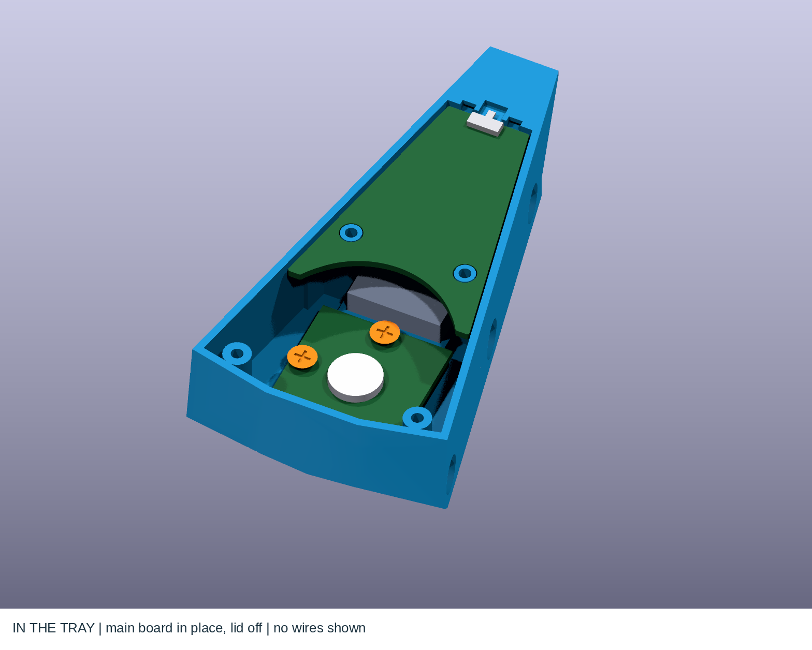

5. **Trackpad only.** Confirm the actual pad has a clear support ring and fit it in the lid on removable adhesive dots. Reserve the packing space above the mostly empty sensor/reset board for the supplied breakout: **24 × 18 × 4.5 mm maximum overall**, including connector, resistors and solder joints, on a **2.5 mm insulating spacer** above the sensor PCB so it clears the screw heads. No printed holder is required. Insulate the breakout's underside and prevent it from moving into screw heads or bare conductors. Keep the original flat cable in its reserved 7 mm-wide bend corridor above the breakout, with slack to lift the lid; route the separate DR lead beside it, and the four breakout wires to the main board's pads. These are explicit clearance envelopes, not measurements of your kit: check its board size, cable length, bend radius and joint height before assembly. Do not sharply fold the FFC or trap it under the lid. Check the complete wired closure before securing the lid.
6. **Trackball only.** Glue the three ceramic balls into the lid's cup.
7. **Lid.** Rear first: tilt the lid, push its two rear hooks into the slots in the back wall, then lower the front. It locates on the tray's rim.
8. **Four M3 × 8 screws** into the lid's countersinks, as on a half: they go into the tray's four posts. Turn them in slowly, and stop when the heads sit flush.
9. Clip the switches through the lid into the sockets, fit the keycaps, and drop the ball in.

Stick three 8 × 2 mm bump-ons into the floor's recesses.

### Power and reset

Same switch and same button in the same place on both modules.

| The power slider, above the USB-C port | Reset, from below |
|---|---|
| 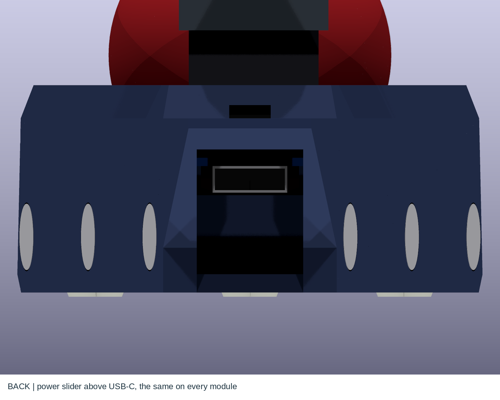 | 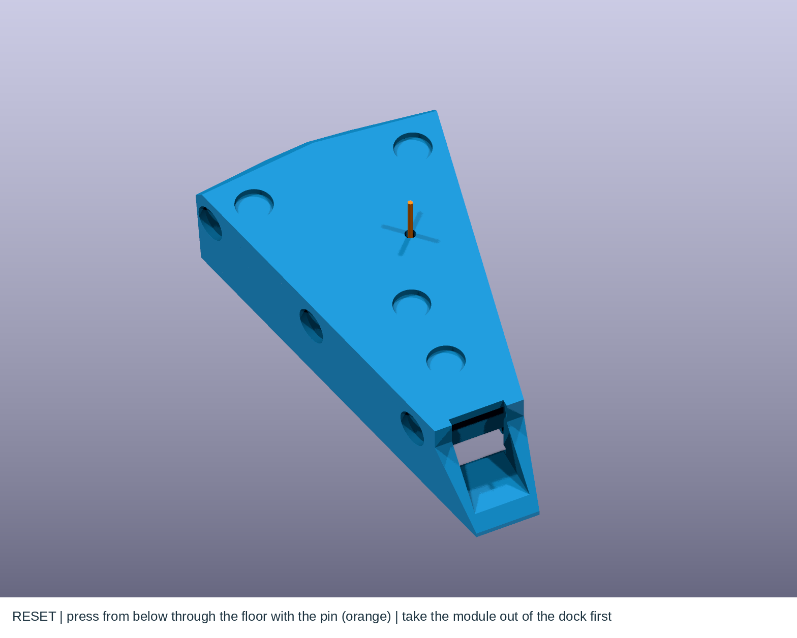 |
| 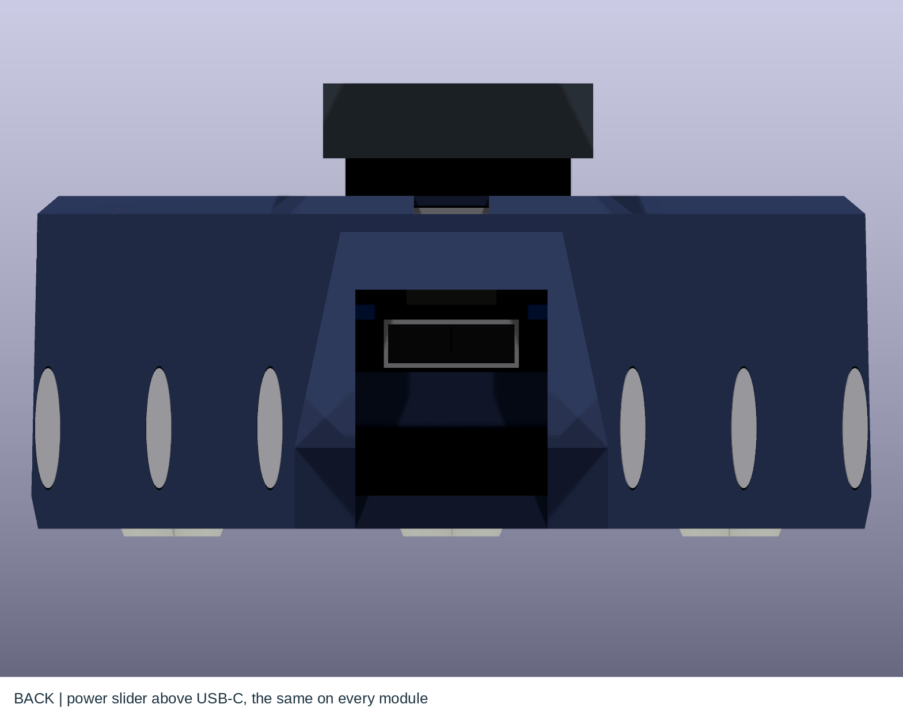 | 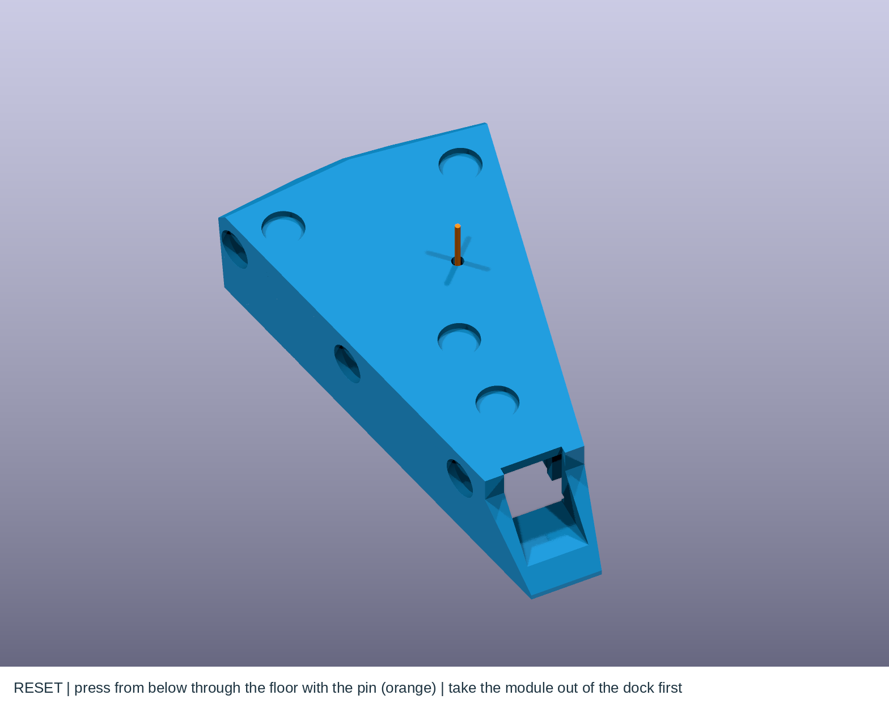 |

The power switch disconnects the battery from both controller and charger: **charging requires the switch on**. USB can power the controller even with the switch off, so unplug USB, switch off and unsolder the battery's `+` lead before working on wiring: the module has no battery connector. Use a protected single-cell Li-ion/LiPo pack rated for the controller's charging voltage and current; the main PCB supplies neither a charger nor battery protection. Verify the exact controller's charger, startup/bootloader current settings, battery rating and charge termination under USB load before charging. On a genuine XIAO the selectable charging current is approximately 50 or 100 mA; do not assume a Super52840 uses the same circuit or setting. See [Seeed's charging documentation](https://wiki.seeedstudio.com/XIAO_BLE/#battery-charging-current). To reset, take the module out of the dock and press a blunt pin, at most 2 mm across, straight into the hole in the floor: once to reset, twice quickly for the bootloader, if supported by the controller's installed bootloader.

### Opening a module

Take it out of the dock, unplug USB, switch it off, and take off the keycaps and ball. Undo the four lid screws and tilt the lid up from the front. The main board stays: it is soldered to the eight stacking pins, so desolder them to take it out. On the trackpad the lid remains attached by the supplied flat cable and the separate DR wire; support it without pulling either, and release the FFC latch if the available slack is insufficient.

## Resetting a closed half

Press straight down into the cone above the thumbs with a fingertip (the pad, not the nail, is enough: the cone is 4.2 mm across at the top and the plunger 2.0 mm wide).

- **Once:** the half reboots.
- **Twice quickly:** the bootloader. With USB plugged in, a USB drive appears: copy a `.uf2` onto it to flash new firmware, as in "Before you start".

## Printing

- **Base:** floor-down, no supports (the wall over the USB recess and the roofs of the pad slots, 8.6 mm wide, bridge). For a quiet, solid base, use 4–5 walls and 40–100% infill (gyroid, or solid). More infill means less hollow sound and more weight.
- **Plate:** **top face down**: the STL is already oriented that way, with the pillars and screw bosses pointing up. The reset button's cone narrows upwards at 45° from the bed (4.2 mm to 2.8 mm over the first 0.7 mm) and needs no support. Print it solid, at 0.2 mm layers. The switch cutouts are 14.0 mm (13.8 mm + 0.1 mm per side); if your switches are loose or tight, change `cut_tol` in `design.py` and regenerate.
- **Module tray:** floor down; the rear hood's underside is designed at 45° for support-free printing. Use 4 walls: the screw posts and the 0.9 mm magnet backings carry the load.
- **Module lids:** top face down; the trackball's cup grows out of the lid as it prints. The intended orientation is support-free.
- Review all module overhangs, particularly the rear hooks, cup and pad ledge, in the actual slicer; support-free printing has not been physically verified. Add removable support if the chosen material and slicer require it, keeping mating surfaces accessible for cleanup.
- **Dock:** flat side down, with supports inside the pocket.
- **Fit:** nominal allowances include 0.35 mm round a module in the drawer, 0.3 mm round a half on the dock, 0.25 mm round a lid in its tray and 0.15 mm radially round a magnet. These are not guarantees against cumulative print error, warping or elephant foot. Calibrate shrinkage and elephant-foot compensation, and use the same filament and settings for mating parts. Check fits before installing electronics; careful local cleanup may be needed, and a successful first print is not guaranteed.
- **Nylon:** dry the filament before printing. It's tough enough to take the self-tapping threads without cracking, and its softness damps key noise.
