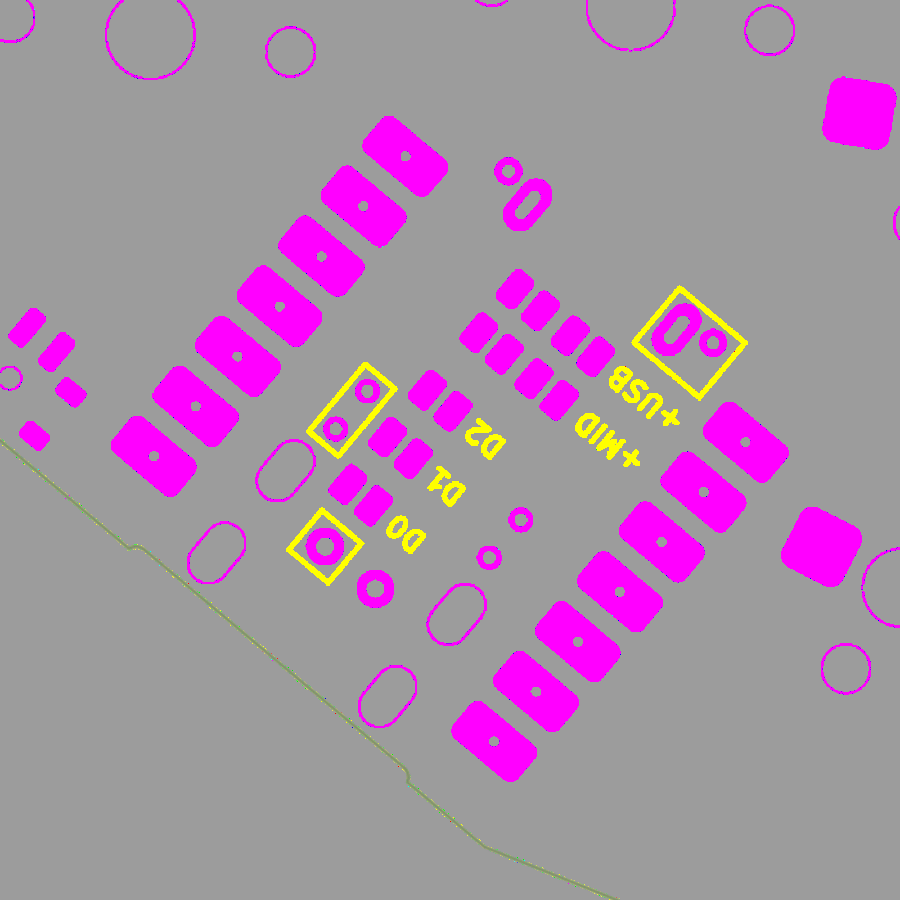
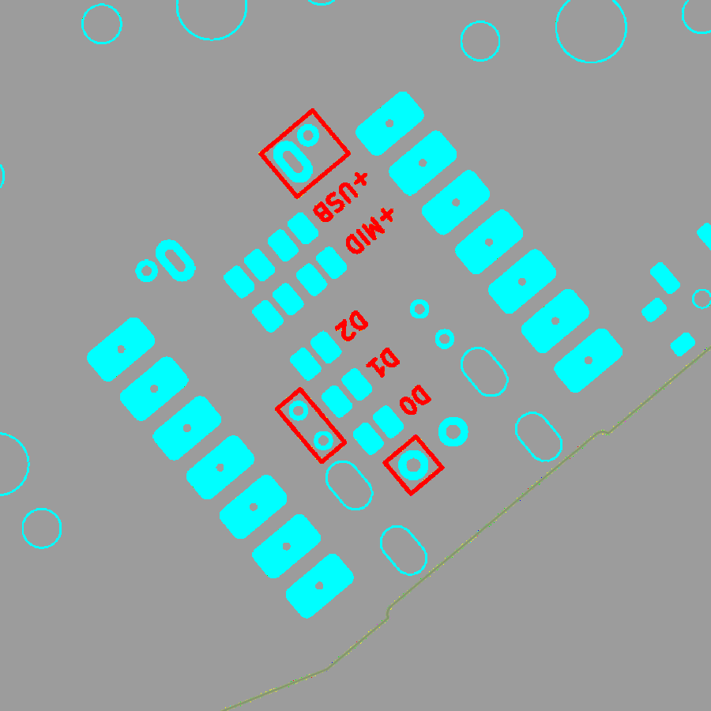
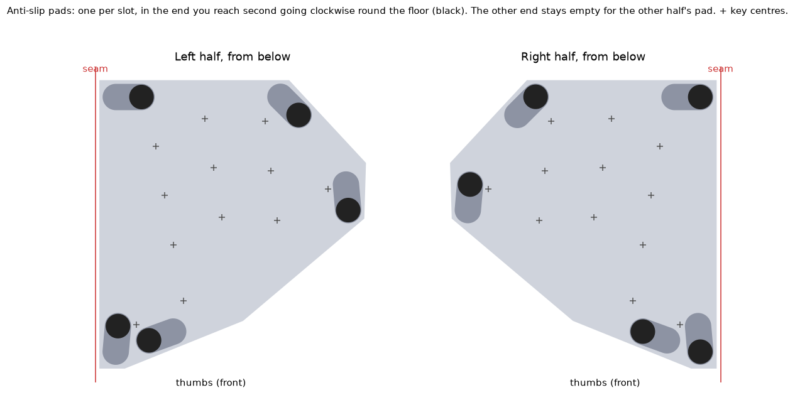

# Slim Diamond: soldering and assembly

The module, battery and battery socket all end up inside the case, under the PCB. Only the USB-C port and the power-switch lever show, through openings in the outer wall: a recess the size of a cable's plug in front of the port, and a slot open to the top for the lever. Push the lever with a fingernail. The module's LED and its own reset button face the case floor, so flash and test it before closing the case. A second reset button on the switch face, wired to the module's reset pad, works with the case closed: it sits in a cone in the plate, above the thumbs.

Everything is soldered with an iron: no paste, no hot air. Build one half at a
time. Both halves use the same PCB, turned over for the right half.

**The module** is a Seeed XIAO nRF52840 or a NologoTech Super52840. The board takes either: a battery selector, set in step 1, matches it to your module. The other steps are the same for both.

## Tools

- Temperature-controlled iron with a **small chisel tip** (1.6–2 mm) for the module, sockets and JST tabs, and a **fine conical tip** for the power switch.
  - Leaded solder: about 330 °C.
  - Lead-free: about 360 °C.
- Thin solder (0.5–0.6 mm), a **flux pen**, fine tweezers, kapton tape, isopropyl alcohol and a brush.
- A multimeter with a continuity beep.
- Optional: a magnifier or phone camera to inspect the small pads.

## The two faces

Each board has a **parts face** and a **switch face**. The silkscreen tells you which is which:

| Half | Parts face (silkscreen) | Switch face |
|---|---|---|
| Left | `LEFT: parts on this face` | the other one |
| Right | `RIGHT: parts on this face` | the other one |

- **Parts face:** the module, power switch, JST socket and the 12 hot-swap sockets. It faces the case floor.
- **Switch face:** the key switches clip in here, the reset button is soldered here, and you bridge the jumpers and fill the module's holes from this side.

The module always lies flat on the parts face, with its pad side against the PCB and its components (USB-C, shield, reset button) pointing away from it, towards the case floor.

## Before you start

- **Flash and test the module first.** Plug it into USB and double-tap reset: a USB drive appears. Copy the firmware onto it:

  | Half | With a dongle | Without a dongle |
  |---|---|---|
  | Left | `slim_diamond_peripheral_left-zmk.uf2` | `slim_diamond_central_left-zmk.uf2` |
  | Right | `slim_diamond_peripheral_right-zmk.uf2` | `slim_diamond_peripheral_right-zmk.uf2` |

  A dead module is much easier to swap now than after soldering.
- **Battery polarity.** Silkscreen `+` marks pin 1 of the JST socket. Cheap 752025 cells ship with either polarity: check the plug with the multimeter. If it's reversed, swap the two crimps in the plug housing (lift each tab with a needle).
- **Magnet polarity.** Every left-half magnet goes in with the same pole facing out, and every right-half magnet with the other pole. That makes both the stack and the side-by-side join attract. Mark one face of each magnet stack before you start.

## 1. Bridge the D0–D2 jumpers and the battery selector (switch face)

On the switch face, inside the module's outline, there are three small pad pairs labelled **D0, D1, D2**, on the face without the module. Flux them and bridge each pair with a small blob of solder.

Next to them is the **battery selector**: two rows of two pad pairs, labelled `+MID` and `+USB`. The two modules have their battery pads in the same spots, swapped, and the row you bridge decides which battery hole is +:

| Module | Bridge both pairs in row |
|---|---|
| Seeed XIAO nRF52840 | `+MID` (its + pad is the one nearer the module's middle) |
| Super52840 | `+USB` (its B+ pad is the one nearer the USB end) |

**Bridge one row only.** Both rows short the battery; the wrong row connects it backwards. Both halves get the same row.

*Left: the left half's switch face. Right: the right half's switch face. Bridge the three D0–D2 pairs and one selector row, and later fill the three boxed hole groups (step 2).*

Leave the jumpers on the other face open: they're on the parts face, under where the module will sit.

**Check:** each bridged pair beeps on the multimeter, and the unbridged selector row doesn't.

## 2. Solder the module (parts face)

1. Flux the 14 edge pads. Lay the module flat over its outline with the USB-C end towards the board edge. The pads are pulled out past the module, so you can reach them from the side.
2. **Tack two opposite corners:** put solder on the iron, touch it to the board pad and the castellation together, and let it flow. Check the module is flat and every castellation sits over its pad. Reheat a corner to adjust it.
3. Solder the other 12 edge pads the same way: iron on the board pad, solder fed into the castellation. Each joint should be a small concave fillet up the half-hole.
4. **Turn the board over (switch face up). Fill the boxed holes:** the pair inside one box (the battery), both holes in the second box (P0.09: one under each module's pad, so fill both), and the round hole in the small square box near the USB end (RST, the module's reset pad). Hold the iron on the ring for 2–3 s and feed solder into the hole until it fills and stops sinking. That means it has wetted the module's pad underneath.
   **Fill only the boxed holes.** The unboxed ones belong to the other half. Most sit under bare module areas; the unboxed reset hole sits under the module's GND test pad, and only wires to the other half's (empty) button pads, so it does no harm either way.
5. Clean off the flux.

The battery holes and one P0.09 hole are smaller than the rest (0.6 mm, as large as the pads above them allow): flux them well, use thin solder (0.5 mm), and hold the iron on the ring until the solder sinks into the hole before you feed more.

**Check:**
- **Before any battery goes in:** the power switch's middle pin (VBAT) must **not** beep to the module's GND castellation. A beep means the wrong selector row, or both: fix it first.
- The battery hole the selector made + beeps to the power switch's middle pin.
- The RST hole does **not** beep to GND (the module's reset is pulled up inside the module: a beep means a solder bridge, and the half would sit in reset).
- No two adjacent castellations beep to each other.

## 3. Power switch, MSK-12C02 (parts face)

It goes next to the module's USB-C, with the lever pointing out over the board edge and its two locating pegs in the small holes.

1. Tin one of the four corner (shield) pads. Place the switch with tweezers and reheat that pad to tack it.
2. Solder the other three shield pads.
3. Solder the three signal pads with the fine tip and very little solder. A bridge between the middle pin and its near neighbour does no harm (both are VBAT). A bridge from the middle pin to the far one bypasses the switch: wick it away.

## 4. JST battery socket (parts face)

Its opening faces the battery's spot under the inner keys. Tack one signal pin, check it sits flat, and solder the other pin. Then solder the two large mounting tabs: they need more heat and more solder, because they take the force of plugging the battery in.

## 5. Hot-swap sockets (parts face)

Twelve, one per key. Each socket fits its outline only one way round.

1. Tin one pad lightly, place the socket, and hold it flat with tweezers while you reheat the pad until the socket's metal tab sinks into the solder.
2. Solder the second tab. Use enough solder to make a fillet, but keep it out of the socket's opening.

## 6. Reset button, TS-1187A (switch face)

It goes on the **switch face**, in the gap above the thumb keys, inside its outline labelled `RST`. The part is square and symmetric: any of the four ways round works.

1. Tin one corner pad, hold the button flat and centred with tweezers, and reheat the pad to tack it.
2. Solder the other three legs: a small fillet on each, iron on the pad and against the leg. Keep the solder off the body: the button is 2.0 mm tall and the plate's pocket over it leaves only 0.3 mm above the collar.

**Check:** the RST hole (step 2.4) beeps to the two legs on the `RST` side of the button (the side with the label), and beeps to GND only while you press the button.

## 7. Test (before the case)

1. Plug in USB. With the firmware flashed and your computer paired or connected, short each socket's two contacts with tweezers. Every key should register.
2. Plug in the battery, unplug USB and toggle the power switch: the half should stay connected.
3. Press the reset button once: the half reboots (it disconnects and reconnects). Press it twice quickly: a USB drive appears (the bootloader), as with the module's own button.

| Symptom | Look at |
|---|---|
| One key dead | That socket's two joints |
| Pinky, ring-bottom or middle-home dead | Its D0–D2 jumper (step 1) |
| Index-top dead (both halves) | The NFC1 / P0.09 hole (step 2.4) |
| Works on USB, not on battery | The battery holes, the selector row (step 1), the power-switch joints, battery polarity |
| Reset button does nothing | The RST hole (step 2.4) and the button's legs (step 6) |
| Half never starts, or keeps rebooting | RST bridged to GND: the RST hole or the button's legs |
| Nothing works | The module's castellations, or the firmware file |

## 8. Case and plate

The base is solid up to the PCB's underside, with a pocket for every part. The PCB rests on plastic everywhere, which makes the half stiff and quiet. The top plate covers the whole board: the switches clip into it, and a shallow pocket in its underside clears the solder around the module.

1. Press the magnets into their pockets (polarity!) and wick a drop of CA glue around each.
2. Lay the battery in its bay and plug it into the JST socket. The plug and the slack of its leads sit in the bay, between the battery and the socket.
3. Lower the PCB, parts face down, into the base. Each part drops into its pocket, the switch lever slides down its slot, and the USB-C port lines up with its recess. Nothing should need force: every pocket has 0.6 mm of clearance, and the PCB 0.5 mm to the outer walls.
4. Lay the plate on top, its pillars and screw bosses resting on the PCB, and fit the four **M3 × 8 flat-head** screws through the plate and PCB. They cut their own thread in the Nylon: turn them in slowly, and stop when the heads sit flush in their countersinks.
5. Clip the switches through the plate into the sockets, then fit the keycaps.
   The reset button now sits under a cone in the plate, between the index finger's bottom key and the thumbs. Its plunger is 0.2 mm under the plate's top, so keycaps and palms don't reach it.
6. **Anti-slip pads.** Each floor has five slots, each long enough for two pads. Stick one 8 × 2 mm bump-on into **one end** of every slot and leave the other end empty: when the halves are stacked back to back, the other half's pad drops into that empty end, so the floors and magnets still meet.

   The rule is the same on both halves: turn the half over and go **clockwise round the floor**. In every slot, the pad goes in the end you reach **second**. Then each half's five pads sit in the ends the other half leaves empty.

   

   Clean the slots with isopropyl alcohol first and press each pad down firmly against the slot's roof, centred in its round end. Stack the halves to check: they should close flat, with no rocking.

## Resetting a closed half

Press straight down into the cone above the thumbs with a fingertip (the pad, not the nail, is enough: the cone is 4.2 mm across at the top and the plunger 2.0 mm wide).

- **Once:** the half reboots.
- **Twice quickly:** the bootloader. With USB plugged in, a USB drive appears: copy a `.uf2` onto it to flash new firmware, as in "Before you start".

## Printing

- **Base:** floor-down, no supports (the wall over the USB recess and the roofs of the pad slots, 8.6 mm wide, bridge). For a quiet, solid base, use 4–5 walls and 40–100% infill (gyroid, or solid). More infill means less hollow sound and more weight.
- **Plate:** **top face down**: the STL is already oriented that way, with the pillars and screw bosses pointing up. The reset button's cone narrows upwards at 45° from the bed (4.2 mm to 2.8 mm over the first 0.7 mm) and needs no support. Print it solid, at 0.2 mm layers. The switch cutouts are 14.0 mm (13.8 mm + 0.1 mm per side); if your switches are loose or tight, change `cut_tol` in `design.py` and regenerate.
- **Nylon:** dry the filament before printing. It's tough enough to take the self-tapping threads without cracking, and its softness damps key noise.
