# Slim Diamond

A wireless Choc v1 Diamond: the Diamond's 1333+2 layout on one reversible
PCB per half, a XIAO-sized nRF52840 module, and a 752025 (250 mAh) battery in
each half. The halves join magnetically into a unibody, or stack back to back for
transport.

## One board, either module

The board takes a Seeed XIAO nRF52840 (the genuine one) or a NologoTech Super52840
(also sold as "MINI NRF52840", "NRF52840 RE:1.4"). Both have the same 14 edge pins
on the same nRF52840 pins, so the firmware is the same; they differ underneath,
where the board reaches the battery, the 12th key and reset:

- **Battery.** Their battery pads are in the same two spots, but swapped: the XIAO's
  + (VBAT) is the pad nearer the module's middle, the Super52840's + (B+) the one
  nearer the USB end. A **battery selector** on the switch face picks which hole is
  +: bridge the row labelled `+MID` for a XIAO, `+USB` for a Super52840. Never both:
  that shorts the battery.
- **12th key (P0.09).** The XIAO's NFC1 pad, or the Super52840's P0.09 pad in its row
  of nine extra GPIO pads: a hole under each, on the same net. Under a XIAO, the
  Super52840's hole touches its NFC2 pad (P0.10), which is unused and idle.
- **Reset** is in the same place on both.
- The Super52840's USB-C legs come through its board: the PCB has clearance holes
  under them, and its USB-C sticks out 0.8 mm further, which the case's recess takes.

The Super52840's pads were measured from several photos, beside a ruler, against the
2.54 mm pin pitch. Its USB-C sits 0.3 to 0.6 mm off centre, towards the D0–D6 pins, so
the leg clearance holes, the notch in the board edge and the case's recess all allow
for that either way (its RST, GND and SWD pads land within 0.2 mm of the XIAO's). The
battery holes are small and sit inside both modules' pads, at least 0.25 mm from the
Super52840's GPIO row under the other half's module, wherever between the two photos'
readings that row really is.

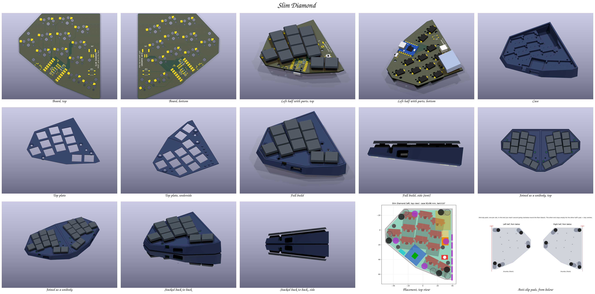

| | |
|---|---|
| Keys | 24 (12 per half): 3×3, one pinky key, two thumbs, all 1u Choc |
| Key layout | The Diamond's angles and stagger (from `body_right.stl`), packed at Choc spacing (18 × 17 mm) |
| PCB | 87.6 × 92.3 mm, 2 layers, 1.6 mm, reversible: one design, order 5. Same cut-diamond outline, so two boards side by side form the diamond. A notch in the edge in front of the USB-C lets a cable's overmold reach the port |
| Wiring | Diodeless, one pin per key (11 Xiao pins + NFC1) |
| Case | Solid base, a pocket per part (0.6 mm clearance), 0.5 mm around the PCB and plate (0.3 at the seam), 93 × 100.5 mm per half at the girdle (the rim is 91.6 × 96.5), with a 45° chamfer under it; tent 6.6°; 18.6 mm at the seam, 8.7 mm at the outer edge (plate included, keycaps excluded). Five pad slots under the floor (below) |
| Anti-slip pads | 5 × 8×2 mm silicone bump-ons per half, as on the original Diamond's base: each slot under the floor (8.6 mm wide, 1.1 deep) holds two pad spots, 8.7 mm apart. Each half sticks its pad in a different end, so stacked, each pad drops into the other half's empty end and the floors (and magnets) still meet. Every key centre sits at least 2.8 mm inside each half's pads, so a press on a border key can't tip it |
| Top plate | Covers the whole board: 1.2 mm Choc v1 plate, 1.0 mm over the PCB (the flange sits 2.2 mm up), 14.0 mm cutouts (`cut_tol` 0.1 per side), a 0.5 mm pocket over the Xiao area for solder blobs, a pocket and cone over the reset button, support pillars, countersunk screw bosses, chamfered bottom edge |
| Power | XIAO nRF52840 or Super52840, 752025 LiPo on a JST PH 2.0 socket, MSK-12C02 power switch next to the USB port on the lower outer facet. The wall has a recess the size of a USB-C overmold (14.6 × 7.4 mm, rounded corners, room for a module whose port sits off centre) in front of the port, and a slot open to the top for the lever, widening outwards for a fingernail, with a rounded floor |
| Reset | A 5.1 × 5.1 × 2.0 mm SMD tact switch (TS-1187A) on the switch face, in the nook between the index finger's bottom key and the thumbs, 7.6 mm from the nearest keycap. It reaches through a 45° cone in the plate (4.2 mm across at the top, 2.8 at the throat) with its plunger 0.2 mm under the plate's top: a fingertip presses it, keycaps and palms don't. Press once to reboot, twice for the bootloader, with the case closed |
| Screws | 4 × M3 × 8 flat head (90° countersunk) per half: through the plate and PCB, self-tapping into the solid Nylon base (2.5 mm pilot). `SCREW` in `design.py` switches to heat-set inserts |
| Magnets | 8×3 mm N52 throughout, 10 per half: 4 in the floor (back to back), spread as far apart as the floor's depth allows (44 mm between the closest two), and 6 in a row along the inner wall (unibody), the most that fit. Every pocket keeps 0.5 mm of plastic all round |
| Assembly | Iron only: no reflow-only parts |

The tent isn't a setting. It is the smallest angle that leaves room under the
inner side of the PCB for the battery (which sits under the index keys' sockets)
and keeps the outer edge as low as the hot-swap sockets allow.

## Before ordering

The board is made in one batch, so check what software can't:

1. **Print** `fab/print_1to1_F_face.pdf` and `fab/print_1to1_B_face.pdf` at 100 % ("Actual
   size", no fit to page). The board outline must measure 87.55 mm across.
2. **Lay the real parts on the prints**, each on the face it's soldered to. The module's
   castellations go over the edge pads, with its USB-C at the board edge. A Choc switch's pins and
   pegs go over one key's holes, and its hot-swap socket over the socket pads on the other face.
   Then the JST socket, the MSK-12C02 (its two pegs in the small holes) and the reset button.
3. **Super52840:** on the print, its B+ and B- pads must cover the two holes in the battery box,
   its `009` pad the round hole in the P0.09 box, and its USB-C legs land inside the two pairs of
   slots. Measure its height from its underside to the top of its USB-C shell: the case allows
   4.3 mm (the XIAO's).
4. **Firmware:** rebuild it before flashing (`b slim_diamond -c` in rafaelromao/keyboards, branch
   `slim-diamond`). `check_pcb.py` confirms that branch lists the board's pins, given the shield's
   `slim_diamond_peripheral_left.overlay` and `_right.overlay` copied to `.render/fw_left.overlay`
   and `.render/fw_right.overlay`.

Checked by the scripts: JLCPCB's limits in the DRC (`pcb/slim_diamond.kicad_dru`: annular ring
0.18, pad holes 0.45 apart, tracks and clearance 0.10, silkscreen 1.0 mm text with a 0.15 stroke),
no tracks under the module's antenna, every net against its intent and the firmware's pin lists
(`check_pcb.py`), both modules' underside pads against the board's copper, and every part, plug,
screw, magnet and pad against the case (`check_fit.py`).

## Files

| Path | What |
|---|---|
| `fab/slim_diamond_jlcpcb.zip` | Gerbers + drill files: upload to JLCPCB as they are |
| `fab/print_1to1_F_face.pdf`, `fab/print_1to1_B_face.pdf` | Both faces at full size, to lay the real parts on before ordering |
| `pcb/` | The KiCad 9 project, its footprint library, 3D stand-ins, and DRC rules |
| `case/case_left.stl`, `case/case_right.stl` | The printed base |
| `case/plate_left.stl`, `case/plate_right.stl` | The printed top plate, oriented top face down for printing |
| `renders/` | Board, board with parts, case, full build; `all.png` has every view on one sheet |
| `BOM.md` | Parts list (AliExpress search terms) |
| `BUILD.md` | Hand-soldering and assembly guide, testing, printing |
| `build-log.html` | The project on one page: both boards, the renders, the BOM and the build guide (open it via raw.githack or GitHub Pages: GitHub shows .html as source) |
| `design.png` | Top view of the placement: sockets (red), Xiao, battery, JST, magnets, screws, the reset button (red, its cone white), pad slots (grey: left pads filled, the right half's dashed) |
| `renders/pads.png` | Both floors from below: where each half's pads go |
| `*.py`, `*.sh` | The generators: everything above is built from them |

## Renders

| Board, top | Board, bottom |
|---|---|
| 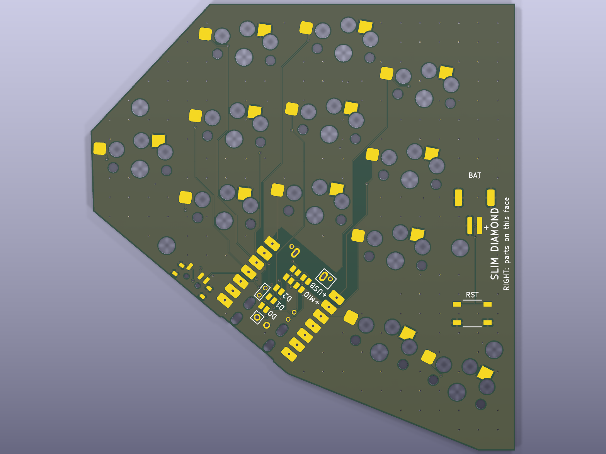 | 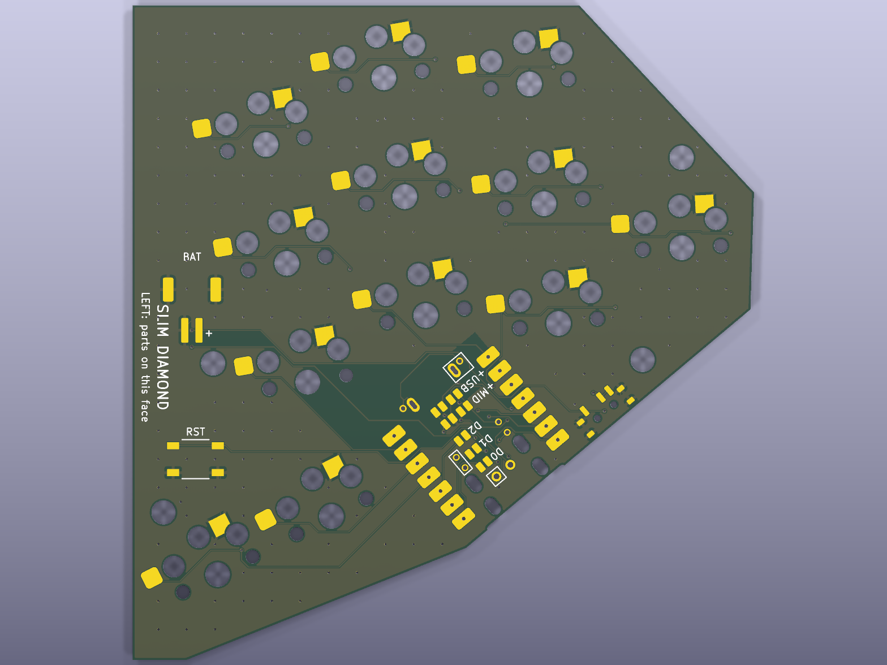 |
| **Left half with parts, top** | **Left half with parts, bottom** |
| 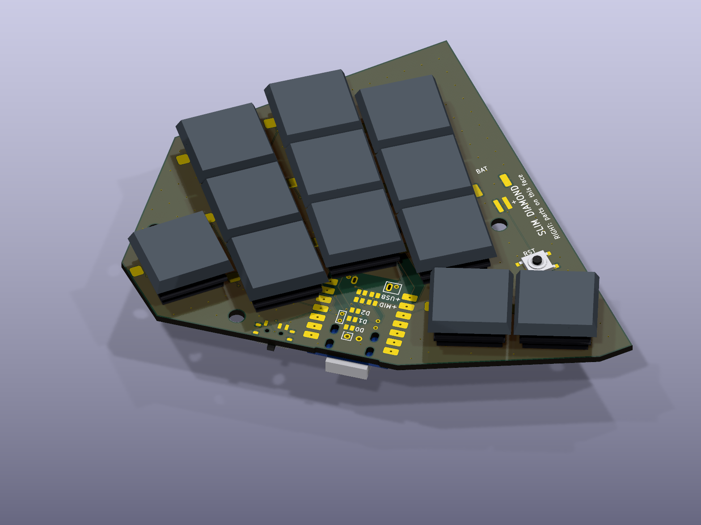 | 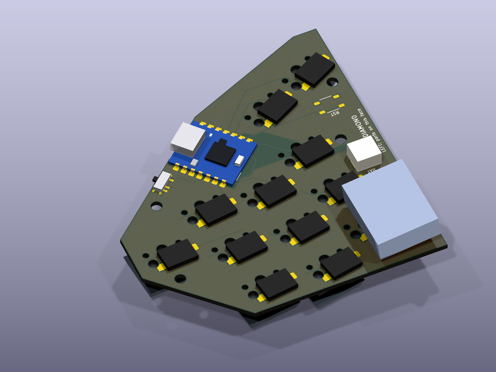 |
| **Case** | **Full build, side (the tent)** |
| 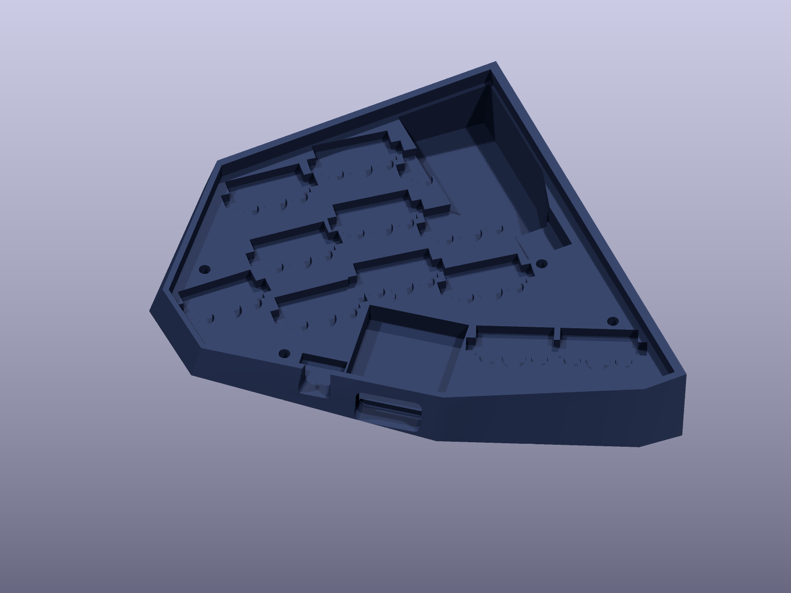 | 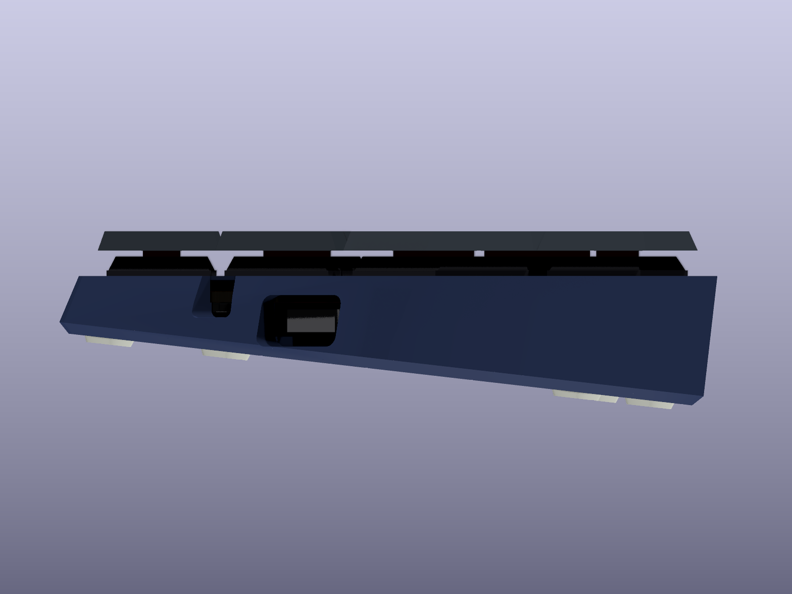 |
| **Top plate** | **Top plate, underside** |
| 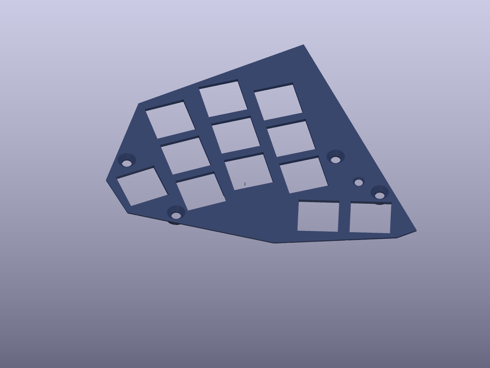 | 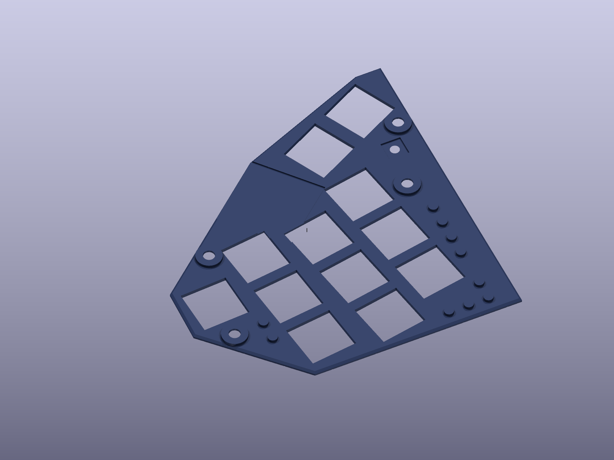 |
| **Joined as a unibody** | **Joined, from above** |
| 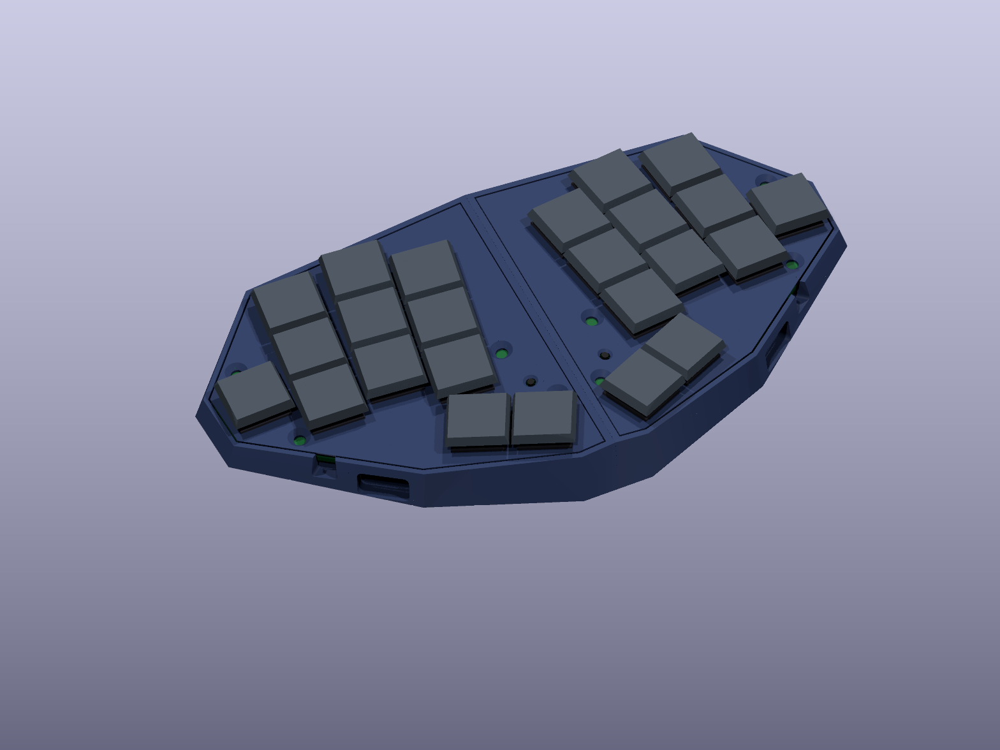 | 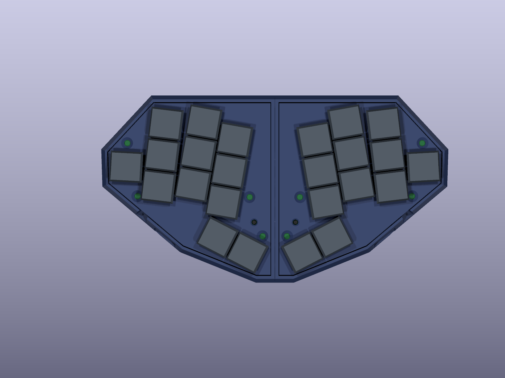 |
| **Stacked back to back** | **Stacked, side** |
| 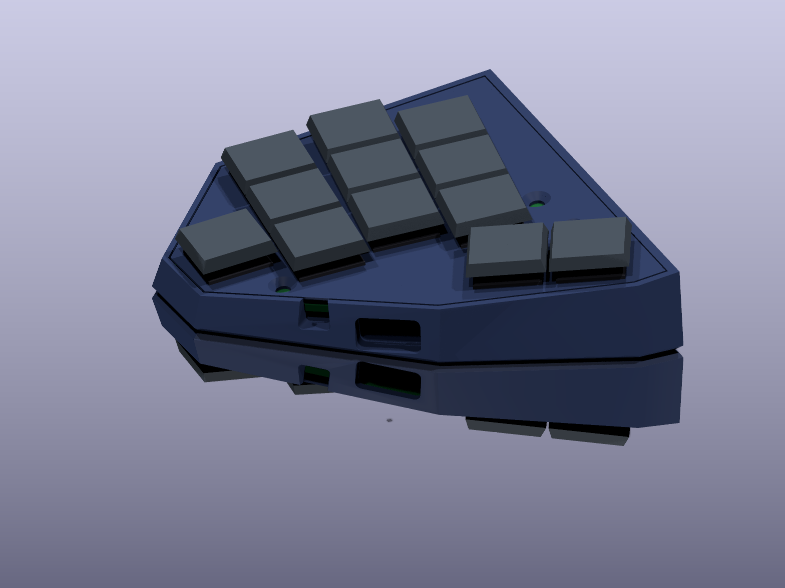 | 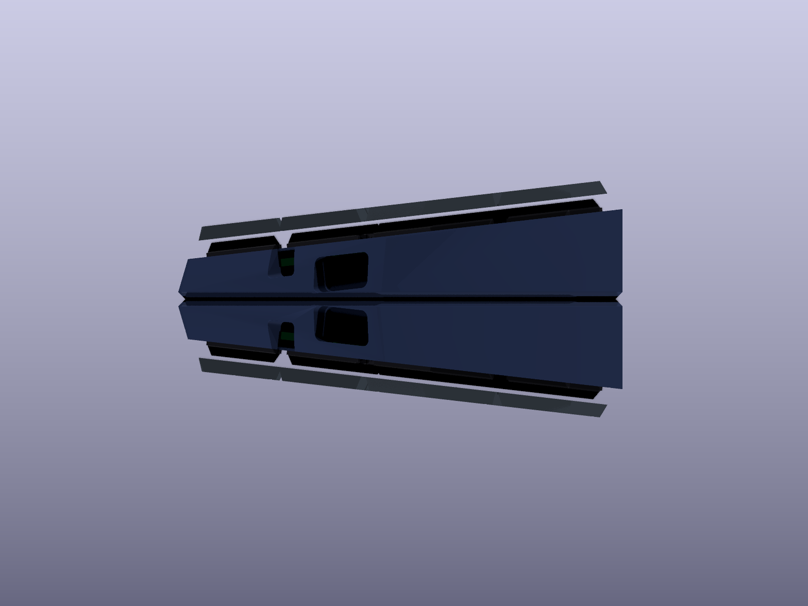 |

## How a reversible board makes two halves

The left half gets its parts on the bottom (B) face. The right half is the same
board turned over, so its parts go on the F face. Silkscreen says which face is
which (`LEFT: parts on this face`).

Turned over, the Xiao's pins land mirrored: where the left half has D0, D1 and D2,
the right half has VBUS, GND and 3V3. Those three pins reach their keys through
solder jumpers. **Bridge the three jumpers on the face without the Xiao** (inside its
outline, labelled D0–D2) and leave the other three open. The other eight edge pins
are GPIO either way. The firmware just lists different pins per half.

Diodeless needs 12 inputs and the Xiao's edge only has 11, so the 12th key uses
the NFC1 pad on the Xiao's underside, through a plated hole you solder from the
other face. NFC itself is not used.

The reset button is wired the same way: the Xiao's reset test pad (pad 17 in
Seeed's footprint, `EN` in their symbol; TP2 on the nRF52840's P0.18/RESET in
Seeed's schematic) is reached through a plated hole filled from the switch face,
and the button joins it to GND. Each half's reset hole has its own net (`RST_L`,
`RST_R`) wired only to that half's button pads: turned over, one half's reset
hole lands under the other half's GND test pad. No pin changes, so the firmware
is unaffected.

Pin map (from `pcb/pinout.json`):

| Key | Left | Right |
|---|---|---|
| pinky | D0 | D0 |
| ring top / home / bottom | D4 / D3 / D1 | D9 / D10 / D1 |
| middle top / home / bottom | D5 / D2 / D6 | D8 / D2 / D7 |
| index top / home / bottom | NFC1 / D7 / D8 | NFC1 / D6 / D5 |
| thumb outer / inner | D9 / D10 | D4 / D3 |

## Firmware

ZMK shield `slim_diamond` in [rafaelromao/keyboards](https://github.com/rafaelromao/keyboards)
(`zmk/keyboards/rafaelromao/slim_diamond`). It builds for `xiao_ble//zmk` with the
same keymap as the other Diamonds:

```sh
b slim_diamond -c   # central left, peripheral left/right, dongle
```

## Regenerating

Requires Python 3 with `requirements.txt`, podman (KiCad 9 runs in the
`docker.io/kicad/kicad:9.0` image through `kicad.sh`), and Freerouting 2.x with
Java 25.

```sh
python3 design.py        # placement, tent, outlines, magnets, screws -> design.json, design.png
FREEROUTING=/path/freerouting.jar ./route.sh   # footprints, board, routing, pours, DRC
./fab.sh                 # gerbers and drill files -> fab/slim_diamond_jlcpcb.zip
python3 magnets.py       # only after a layout change: measures the base for the magnets to pin in design.py
python3 case.py          # base and plate STLs (and their 3D models for renders)
python3 check_fit.py     # parts, plate, solder blobs, the reset button and its cone, screws, magnets, pad slots, a USB-C plug and the lever against
                         # the case, the pads stacked, and the pads' balance: all 0 mm³, ALL CLEAR
./kicad.sh python3 check_pcb.py   # every net against its intent, and the firmware's pin lists: ALL CLEAR
python3 vrml.py && python3 scene.py && ./kicad.sh python3 render_boards.py && ./render.sh
python3 page.py          # build-log.html's BOM and build-guide sections, from BOM.md and BUILD.md
```

`layout.py` holds the Diamond geometry. `design.py` places everything else and
holds the tolerances. The outline is the fewest-facet (`GEM_FACETS`) convex
polygon around both halves joined. `XIAO_SPOT` pins the Xiao's position;
set it to `None` to search again, and if the board won't route completely, try
the runners-up the search writes to `xiao_alternatives.json`. `RESET_SPOT` pins the reset button and `BUTTON` holds its datasheet heights
and the plate's pocket and cone; `design.py` asserts its clearances. `PAD_SLOTS` pins the
pad slots the same way (`None` searches again for the slots that keep every key
centre deepest inside both halves' pads). `MAG_FLOOR_SPOTS` and `MAG_SIDE_SPOTS` pin the
magnets, found by `magnets.py` against the solid base around the pads, parts and screws.

Credits: the Choc hot-swap footprint follows [kiswitch](https://github.com/kiswitch/kiswitch)
(MIT). The Xiao pad positions follow Seeed's
[OPL KiCad library](https://github.com/Seeed-Studio/OPL_Kicad_Library). The reset button's pads follow
KiCad's `Button_Switch_SMD:SW_SPST_TL3342` from the
[official footprint library](https://gitlab.com/kicad/libraries/kicad-footprints) (CC-BY-SA 4.0), which
matches XKB's TS-1187A land pattern.
